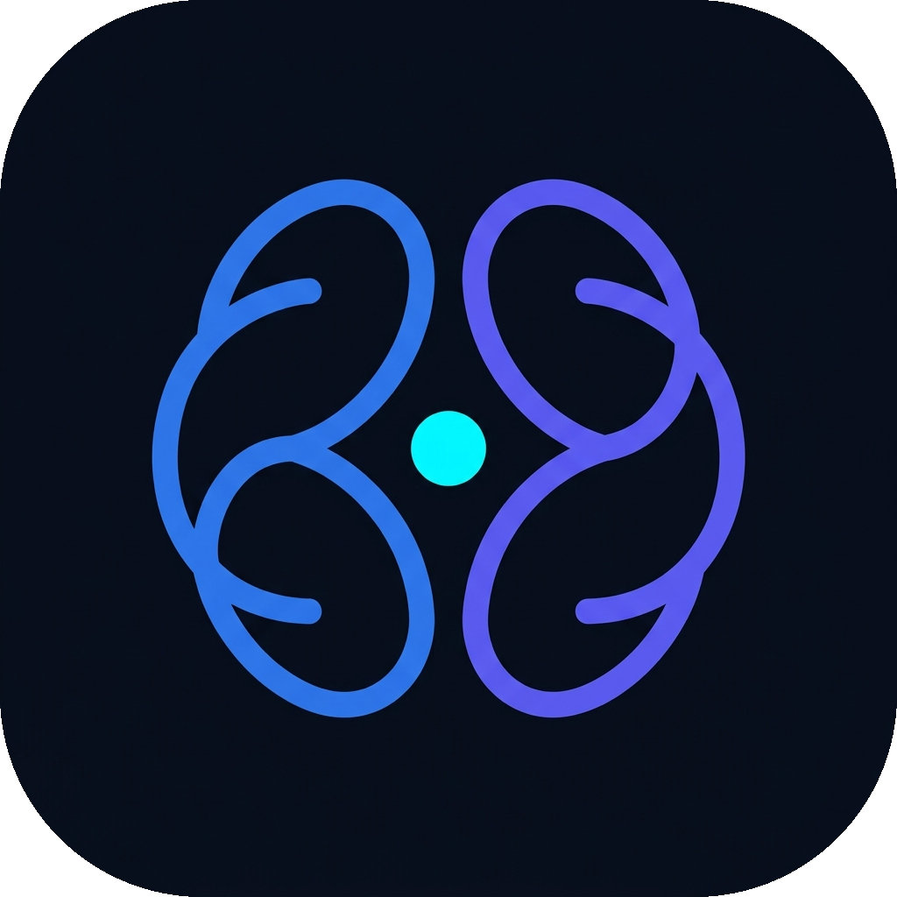

  

<h1 align="center">Second Brain</h1>

  <strong>Never lose a thought.</strong>

  An offline-first personal productivity system designed to capture ideas instantly, organize daily tasks, plan schedules, and track continuous learning across your desktop and phone.

  <a href="https://github.com/sakibnjr/second-brain/releases"><strong>Download Latest Release</strong></a> •
  <a href="https://github.com/sakibnjr/second-brain/releases/tag/v1.0.0"><strong>Linux (.deb)</strong></a> •
  <a href="https://github.com/sakibnjr/second-brain/releases/tag/v1.0.0"><strong>Android (.apk)</strong></a>

---

## ✨ Features

### 📋 Tasks & Board
- **Flexible Views:** Organize tasks using an interactive Kanban board or a clean, focused list view.
- **Priority & Deadlines:** Categorize by urgency (Low, Medium, High), assign due dates, and monitor overdue items at a glance.
- **Fast Quick-Add:** Capture tasks immediately with instant keyboard shortcuts or quick inline bars.

### 💡 Idea Inbox
- **Zero Friction Capture:** Quickly jot down spontaneous thoughts, meeting notes, and inspirations before they slip away.
- **Instant Search:** Find any idea or note immediately with real-time text search.
- **Archive & Organization:** Keep your active workspace clutter-free by archiving completed thoughts while keeping them accessible.

### 🎓 Learning Tracker
- **Course & Reading Tracking:** Keep tabs on courses, books, technical tutorials, and skill tracks.
- **Visual Progress:** Interactive progress tracking with percentage meters and quick adjustments.
- **Structured Milestones:** Log study sessions and organize resources with provider links and notes.

### 📅 Schedule & Calendar
- **Date-Based Planning:** Visualize your workload across days and weeks.
- **Agenda Review:** Inspect scheduled tasks for any chosen day and balance your schedule effortlessly.

### 🔒 Offline-First & Private
- **Local Vault:** Works 100% offline. All your data is saved locally on your device with zero network lag.
- **Bidirectional Cloud Sync:** When online, your records seamlessly synchronize across your Linux desktop and Android phone.
- **Obsidian Dark & Pure Light:** Thoughtfully crafted dark and light modes built for focus day and night.

---

  Second Brain — Built for clear thinking and intentional living.

